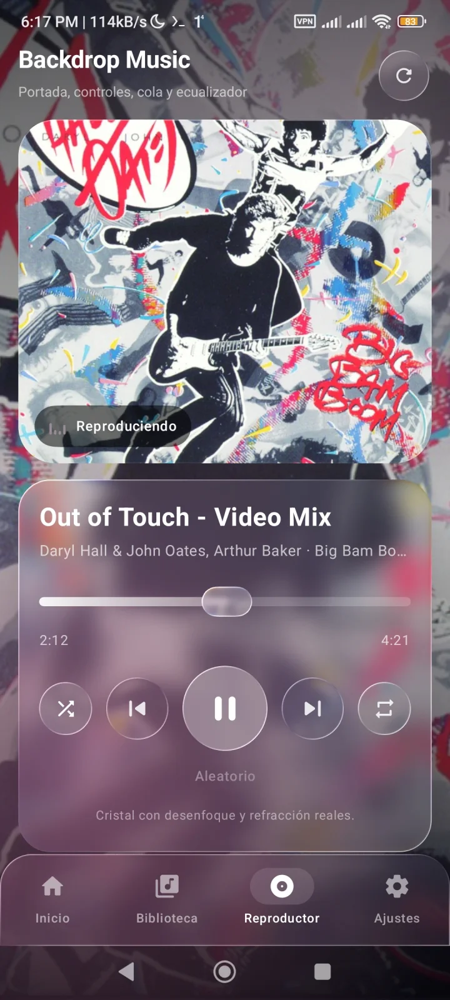
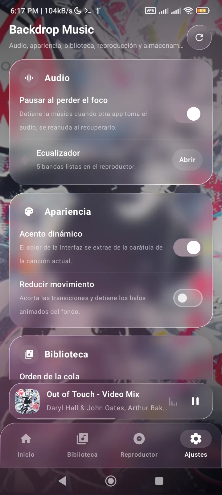
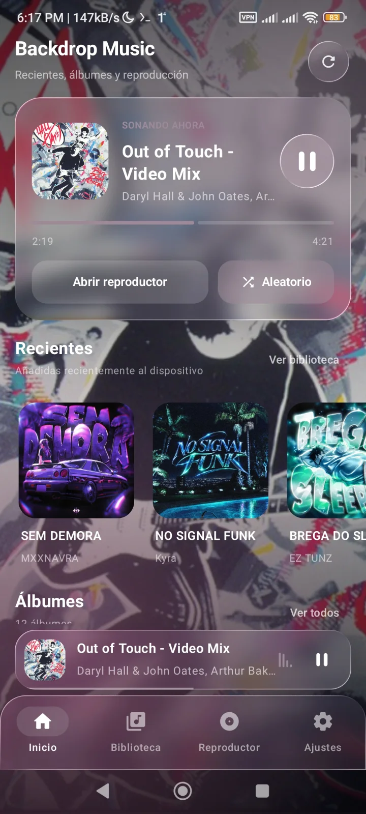

# Backdrop Music (`examples/backdrop-music`)

Reproductor de música **real** para Android escrito en **Kotlin + Jetpack
Compose**, con paneles de cristal de
[`io.github.kyant0:backdrop`](https://kyant.gitbook.io/backdrop/).

A diferencia de `examples/liquid-glass` (demo de UI con pistas inventadas y
progreso simulado), este ejemplo lee el audio del dispositivo con `MediaStore`,
lo reproduce con `MediaPlayer` y muestra el cristal como efecto real sobre el
contenido de la pantalla.

## Capturas

<p align="center">
  
  
  
</p>

Capturas reales de Backdrop Music en un dispositivo Android, compilada y
firmada con Rain (`rain --devlog build`), sin Gradle ni Android Studio.

## Qué hace

La app tiene cuatro secciones pensadas para un reproductor completo:

- **Inicio.** Hero con la pista actual, progreso real y acceso al reproductor,
  botón de reproducción aleatoria, canciones recientes, álbumes y un resumen de
  la biblioteca (pistas, álbumes y artistas).
- **Biblioteca.** Canciones, artistas, álbumes, géneros y carpetas agrupados
  desde `MediaStore`. Tiene búsqueda por título, artista, álbum, género o
  carpeta, filtros por grupo y acceso directo a cada pista.
- **Reproductor.** Portada, metadatos animados, barra de progreso arrastrable,
  controles de reproducción, aleatorio, repetición (off/todo/una), cola
  desplegable y ecualizador real.
- **Configuración.** Audio (foco de audio y acceso al ecualizador), apariencia
  (acento dinámico y reducir movimiento), biblioteca (orden, reescaneo y caché
  de carátulas), reproducción (auto-inicio, aleatorio y repetición) y
  almacenamiento (estadísticas y restablecer ajustes).

Además:

- **Biblioteca real.** Consulta `MediaStore.Audio.Media.EXTERNAL_CONTENT_URI`
  y lista las pistas del dispositivo (`IS_MUSIC != 0`, duración ≥ 15 s para
  descartar tonos y avisos del sistema).
- **Reproducción real.** `MediaPlayer` con `AudioAttributes` de tipo música,
  foco de audio (`AudioFocusRequest`) y liberación del reproductor al cambiar
  de pista o cerrar la actividad. La cola avanza sola al terminar.
- **Ecualizador real.** `android.media.audiofx.Equalizer` sobre la sesión de
  audio del reproductor; las bandas se leen del dispositivo y cada cambio se
  aplica en el momento. Si el teléfono no lo permite, se explica en el panel.
- **Carátula real.** Se extrae la imagen incrustada en el archivo (o la
  miniatura de `MediaStore` en Android 10+) y su color dominante se usa como
  acento animado de la escena. Las carátulas se cachean en memoria.
- **Cristal real.** El fondo (degradado, carátula atenuada y halos en
  movimiento) se graba en un `LayerBackdrop`; los paneles lo copian con
  `Modifier.drawBackdrop` y le aplican `vibrancy`, `blur` y `lens`.
- **Estados honestos.** Permiso pendiente, cargando, biblioteca vacía, error de
  lectura y error de reproducción tienen su propia tarjeta con una acción
  útil. Nada se simula.

## Checklist de funciones

Estado real de esta versión. `[x]` está implementado y verificado por
compilación; `[ ]` está pendiente o es parcial, y se indica qué falta. No se
marcan como hechas funciones que solo existen como maqueta.

- [x] **Reproducción local:** MP3, FLAC, WAV y los formatos que el
  `MediaPlayer` del dispositivo sepa decodificar. Se reproduce directamente la
  URI de `MediaStore`, sin copiar archivos ni usar la red.
- [x] **Biblioteca musical:** escaneo de `MediaStore`, metadatos (título,
  artista, álbum, género, carpeta, duración y tamaño) y agrupación por
  artistas, álbumes, géneros y carpetas.
- [ ] **Cola y listas:** la cola se muestra y se puede saltar a cualquier
  pista; faltan reordenación por arrastre y persistencia de la cola entre
  sesiones.
- [ ] **Servicio en segundo plano:** la reproducción vive en un `ViewModel`
  mientras la actividad sigue viva; falta `MediaSessionService`, notificación
  multimedia y controles en la pantalla de bloqueo.
- [x] **Búsqueda y ordenación:** búsqueda por título, artista, álbum, género y
  carpeta; orden por título, artista, álbum o recientes; filtros por grupo.
- [ ] **Temas Material 3 Expressive:** ya hay Material 3, tema oscuro y
  navegación; faltan los componentes Expressive y un diseño adaptable para
  tablet y plegables.
- [ ] **Ecualizador:** bandas reales del dispositivo con ganancia ajustable y
  restablecer; faltan preajustes (rock, jazz, etc.) y guardar curvas propias.
- [ ] **Letras y editor de etiquetas:** no implementado; faltan letras LRC y
  edición de metadatos de archivos.
- [ ] **Temporizador:** no implementado; falta la detención automática.
- [ ] **Radio por Internet:** no implementado; faltan URLs y listas de
  emisoras.
- [ ] **Widgets y Android Auto:** no implementado; faltan ambas integraciones.
- [x] **Icono de aplicación:** icono adaptativo propio (`@mipmap/ic_launcher`)
  con fondo degradado índigo, nota musical vectorial y capa monocroma para los
  iconos temáticos de Android 13+. Sin recursos raster ni icono por defecto del
  sistema.

## Permisos

| Android | Permiso | Motivo |
| --- | --- | --- |
| 13+ (API 33) | `READ_MEDIA_AUDIO` | Acceso granular al audio |
| 8–12 (API 26–32) | `READ_EXTERNAL_STORAGE` (`maxSdkVersion="32"`) | Modelo de almacenamiento anterior |
| Todas | `MODIFY_AUDIO_SETTINGS` | Permiso normal del ecualizador del sistema |

El permiso se pide en runtime con `rememberLauncherForActivityResult` y se
vuelve a comprobar en cada `ON_RESUME`, así que concederlo desde **Ajustes**
recarga la biblioteca sin reiniciar la app.

No se declara `INTERNET` ni se sube nada: todo ocurre en el dispositivo.

## Compilar e instalar

Requiere el toolchain Android y Kotlin (`rain doctor --fix --profile complex`).

```bash
cd examples/backdrop-music
../../rain --devlog build
```

El APK queda en:

```text
app/build/BackdropMusic-1.0-universal.apk
app/build/app-debug.apk          # ruta estable que usa CI
```

Verificación de firma (lo mismo que hace CI):

```bash
java -jar ~/.rain/toolchain/apksigner.jar verify --verbose app/build/app-debug.apk
```

Instalación y prueba:

```bash
adb install -r app/build/app-debug.apk
```

Para probarlo hace falta audio local: copia archivos al dispositivo (o usa
`adb push cancion.mp3 /sdcard/Music/`) y espera a que el sistema los indexe.
En el emulador puedes arrastrar un MP3 a la ventana; si no aparece, ejecuta
**Ajustes → Almacenamiento → Borrar caché de medios** o reinicia el emulador.

## Estructura

```text
backdrop-music/
├── rain.toml                     # mode = "completo", Compose, Backdrop, SDK 26/36
├── app/
│   ├── AndroidManifest.xml       # permisos de audio + actividad
│   ├── java/com/kyant/backdrop/music/
│   │   ├── MainActivity.kt       # permiso runtime, 4 pestañas, estados y tema
│   │   ├── HomeScreen.kt         # inicio: hero, recientes, álbumes y resumen
│   │   ├── PlayerScreen.kt       # reproductor, cola, ecualizador y biblioteca
│   │   ├── SettingsScreen.kt     # audio, apariencia, biblioteca, reproducción y almacenamiento
│   │   ├── MusicLibrary.kt       # MediaStore, grupos y carátulas
│   │   ├── MusicSettings.kt      # preferencias persistidas y orden
│   │   ├── PlayerController.kt   # MediaPlayer, foco de audio, ecualizador y cola
│   │   └── Glass.kt              # LayerBackdrop, blur/lens, paneles y navegación
│   ├── res/                      # icono adaptativo (v26) y monocromo (v33)
│   └── build/                    # generado por Rain (ignorado por git)
├── cache/                        # POMs descargados (ignorado por git)
└── .rain-deps/                   # AAR/JAR preparados (ignorado por git)
```

## Cómo funciona el cristal

`SceneBackground` dibuja la escena. El `Box` raíz lleva
`Modifier.layerBackdrop(backdrop)`, que graba todo lo que se pinta dentro del
`Box` en un `LayerBackdrop`. Después, `GlassPanel`, `GlassIconButton` y
`GlassNavigationBar` usan `Modifier.drawBackdrop` con la forma del panel y dos
efectos:

```kotlin
effects = {
    blur(18.dp.toPx())
    lens(
        refractionHeight = 14.dp.toPx(),
        refractionAmount = 22.dp.toPx(),
        depthEffect = true,
        chromaticAberration = true,
    )
}
```

La superficie translúcida (`onDrawSurface`) se pinta *encima* del fondo
copiado, no en lugar de él: por eso el texto sigue siendo legible.

## Cómo se extrae el acento dinámico

`ArtworkLoader.dominantColor()` reduce la carátula a 24×24 px y recorre los
píxeles:

1. Descarta los transparentes (`alpha < 0,5`) y los casi negros o casi blancos
   (`luminancia < 0,06` o `> 0,94`), que ensucian la media.
2. Pondera cada píxel por su saturación (`0,4 + saturación`) para que un fondo
   gris o una foto apagada no anulen el color dominante.
3. Suma los canales RGB ponderados, los divide por el peso total y aclara el
   resultado un **8 % hacia blanco**, para que el acento se note sobre el
   cristal sin volverse fluorescente.
4. Si no queda ningún píxel válido, usa `DefaultAccent` (`#8B8CF8`, lavanda).

El cálculo ocurre una sola vez por carátula en un hilo de E/S y se guarda en la
caché de `ArtworkLoader` junto a la imagen. `MainActivity` interpola el color
con `animateColorAsState` (700 ms; 0 ms con **Reducir movimiento**) y lo pasa a
la escena, los iconos, los indicadores y los controles. El ajuste **Acento
dinámico** permite desactivarlo y volver siempre al lavanda por defecto.

Las etiquetas de acción **“Abrir”** y **“Escanear”** de Configuración se
dejaron deliberadamente en **blanco** (y “Cerrar” del error también): el texto
pequeño sobre cristal gana contraste así, mientras el acento sigue marcando
iconos, selección y progreso.

## Límites por versión de Android

El cristal no se comporta igual en todos los dispositivos, y la app lo dice en
el propio reproductor:

| Android | `blur` | `lens` (refracción) | Lo que se ve |
| --- | --- | --- | --- |
| 13+ (API 33) | Sí | Sí | Cristal completo con refracción y aberración |
| 12 (API 31–32) | Sí | No | Desenfoque real, sin refracción |
| 8–11 (API 26–30) | No | No | Tinte translúcido, contenido legible |

La librería ignora los efectos no soportados en vez de fallar. `min_sdk` es 26
porque `blur` y `RenderEffect` son la parte deseable, pero el ejemplo arranca y
funciona (con tinte) en versiones anteriores.

## Decisiones de UI/UX

- **El cristal no tapa el contenido sin más.** Cada panel combina un velo
  blanco de baja opacidad con el fondo desenfocado; sin el velo, un fondo con
  mucho contraste haría ilegible el texto.
- **La escena se mueve despacio** (24 s, ida y vuelta) para que el desenfoque
  se note sin distraer de los controles.
- **Barra de progreso con arrastre diferido.** Se actualiza la posición
  mientras se arrastra, pero solo se llama a `MediaPlayer.seekTo` al soltar,
  para no reiniciar el decodificador en cada píxel.
- **Zona táctil de 48 dp** para el slider aunque la barra visible sea de 14 dp;
  expone `ProgressBarRangeInfo`, `stateDescription` y `setProgress` para
  TalkBack.
- **Iconos, no emojis.** Todo usa `ImageVector` + `Icon` de
  `material-icons-extended`; los controles llevan `contentDescription` y los
  iconos decorativos pasan `null`.
- **Reproductor en `ViewModel`.** La reproducción y la cola sobreviven a la
  rotación; el estado de UI (pestaña, permisos) usa `remember`/`rememberSaveable`.
- **Ajustes persistentes.** `MusicSettings` guarda orden, aleatorio, repetición,
  foco de audio, acento dinámico y reducción de movimiento en
  `SharedPreferences`; los controles del reproductor y la pantalla de
  Configuración comparten el mismo estado.
- **Animaciones con propósito.** `AnimatedContent` mueve las páginas,
  `Crossfade`/zoom funde la carátula al cambiar de canción, los metadatos se
  deslizan y el acento de la escena interpola el color dominante de la portada.
  **Reducir movimiento** acorta o desactiva estas animaciones.
- **Recarga sin cortar la música.** `updateQueue` conserva la pista actual si
  sigue existiendo; si no, reinicia la cola en la primera pista en pausa.
- **Errores en la propia tarjeta**, con la pista afectada y el código de
  `MediaPlayer`, en vez de un `Toast` que se pierde.

## DX: cosas que suelen fallar

- `../../rain` es el binario del repo. Si está desactualizado, ejecuta
  `make build` en la raíz antes de probar el ejemplo.
- No edites `app/build/`, `cache/` ni `.rain-deps/` a mano: se regeneran.
- `io.github.kyant0:backdrop:2.0.1` publica en la raíz solo metadata KMP; el
  código Android está en `io.github.kyant0:backdrop-android:2.0.1`, que Rain
  resuelve solo siguiendo `available-at`.
- Backdrop arrastra alias de `org.jetbrains.compose.*` que en Android son AAR
  vacíos. Rain recorre sus POMs para descubrir las dependencias
  `androidx.compose.*`, pero los excluye del classpath: si se preparasen,
  compartirían nombre de archivo con los AAR reales y los sobrescribirían.
- El primer build descarga Compose completo (incluido
  `material-icons-extended`) y tarda minutos; los siguientes reutilizan
  `cache/`, `.rain-deps/` y el DEX de dependencias.
- Si el emulador no tiene pistas, la app muestra el estado **No hay música
  todavía** en la pestaña Biblioteca: es el comportamiento esperado, no un
  fallo de permisos.

## Pendiente

- **Probar `../../rain build --devlog --release --allow-debug-signing`.** El
  ejemplo no tiene keystore de release; el flag firma con la de debug y avisa.
  El build debug ocupa 17 MB de APK y unos 80 MB instalados porque no hay R8 y
  `material-icons-extended` conserva todas sus variantes (~9.900 clases). Hay
  que medir el APK release, verificar la firma y comprobar que la app sigue
  funcionando (reproducción, ecualizador, carátulas y acento dinámico), además
  de comparar el tamaño instalado.
